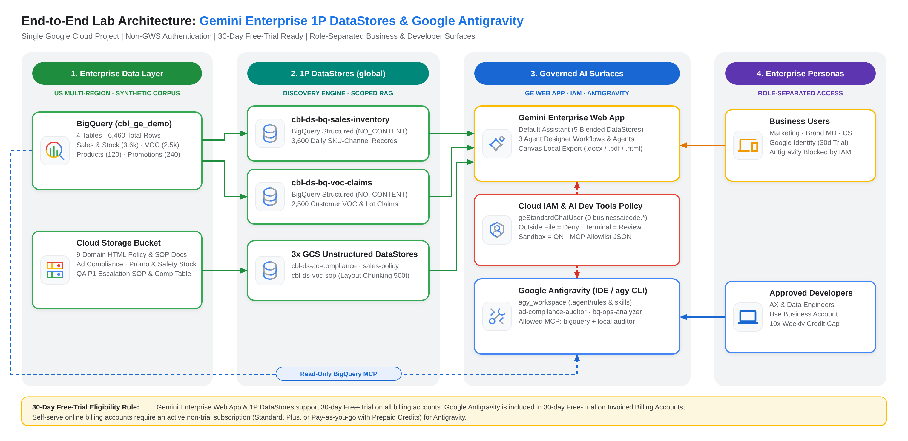
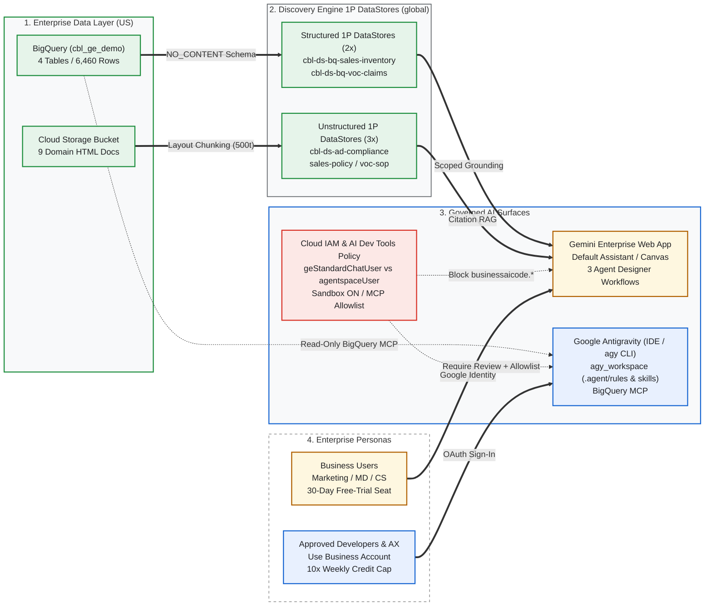

# Gemini Enterprise 1P Connector & Google Antigravity Hands-On Demo Lab

**Google Workspace**(`GWS`)를 사용하지 않는 일반 기업 환경에서 단일 Google Cloud Project와 **30일 무료 체험 License**(`Free-trial`)만으로 **Gemini Enterprise**(`GE` Web App · 1P DataStore · Agent Designer Workflow) 및 **Google Antigravity**(`agy` AI Developer IDE / CLI) 환경을 구축하는 Step-by-Step Hands-On Lab Repository입니다.

모든 실습 과정(`Setup` ~ `Task 05`)은 관리자와 현업 담당자를 위한 **Track A**(Google Cloud Console / Web UI 따라하기)와 빠른 환경 재현을 위한 **Track B**(자동화 Script 실행하기) 두 가지 경로를 함께 안내합니다.

---

## 1. End-to-End Lab Architecture

가상 소비재 기업 **Cymbal Beauty & Living**(`CBL`: Beauty · HDB · Refreshment 부문) 시나리오를 기반으로 정형 실적·클레임 Dataset(`BigQuery` 4개 Table, 총 6,460 Row)과 비정형 규정·SOP 문서(`Cloud Storage` 9종 HTML)를 단일 Project 안에 구성합니다. 일반 현업 임직원은 **Gemini Enterprise Web App**에서 업무별 전용 Workflow와 Canvas를 활용하며 승인된 개발자 및 AX 담당자는 동일한 데이터 자산을 **Google Antigravity**에서 연결해 배치 검수기와 운영 분석 도구를 개발합니다.



- **편집 가능한 Architecture Diagram 원본**: [3-Page 통합 Workbook (`ge_agy_architecture_diagrams.drawio`)](assets/diagrams/ge_agy_architecture_diagrams.drawio) · [단일 Page (`01_end_to_end_architecture.drawio`)](assets/diagrams/01_end_to_end_architecture.drawio) · [Vector SVG (`01_end_to_end_architecture.svg`)](assets/diagrams/01_end_to_end_architecture.svg)

<details>
<summary><b>Mermaid Diagram 원본 보기 (GitHub Native Flowchart)</b></summary>



</details>

---

## 2. 사전 요구사항 및 30일 체험 License 지원 범위

실습을 시작하기 전에 대상 Google Cloud Project에 연결된 **Cloud Billing Account 유형**을 먼저 확인하세요. 공식 구독 정책에 따라 30일 무료 체험 License의 지원 범위가 달라집니다.

| Cloud Billing Account 유형 | Gemini Enterprise (`Task 00 ~ Task 03`) | Google Antigravity (`Task 04 ~ Task 05`) | 비고 |
|---|---|---|---|
| **Invoiced Billing Account** (후불 청구서 발행 계정 및 하위 Subaccount, 사내 Sandbox 포함) | **30일 체험 License 가능** | **30일 체험 License 가능** (체험 Quota 제공) | 단일 30일 체험 구독으로 전 과정(`Task 00 ~ 05`) 실습 가능 |
| **Self-serve Billing Account** (신용카드 자동결제 Online 계정) | **30일 체험 License 가능** | **30일 체험 불가** (`Non-trial` 구독 필요) | `Task 00 ~ 03`은 30일 체험으로 진행하고 `Task 04 ~ 05`는 `Pay-as-you-go`(`Prepaid Credits`) 또는 `Standard`/`Plus` 구독 필요 |

> [!IMPORTANT]
> 모든 `Free-trial` 구독은 한도 초과 종량 과금(`Pay-as-you-go usage above quota`)을 지원하지 않습니다. 좌석 배정 직후 Backend `Entitlement Cache` 동기화에 5~15분 정도 걸릴 수 있으니 `Task 00`에서 **무료 체험 활성화와 좌석 배정을 가장 먼저 완료**해 두세요.

---

## 3. 실습 진행 목차 (Qwiklabs-Style Step-by-Step Guide)

| 단계 | Guide 문서 | 주요 실습 내용 (`Console UI` + `Script` 병행) | 권장 시간 |
|---|---|---|---|
| **Setup** | [labs/task00_setup_and_trial.md](labs/task00_setup_and_trial.md) | 필수 API 활성화, `GE` 30일 체험 License 발급·좌석 할당, `Google Identity` 인증 및 `GE App` 생성 | 10분 |
| **Task 01** | [labs/task01_synthetic_data.md](labs/task01_synthetic_data.md) | 외부 의존성 없는 Python 기반 중규모 가상 데이터(`BigQuery` 4개 Table 6,460 Row + `GCS` HTML 문서 9종) 생성 및 적재 | 15분 |
| **Task 02** | [labs/task02_1p_datastores.md](labs/task02_1p_datastores.md) | `GCS`(비정형 3종) 및 `BigQuery`(정형 2종) 1P DataStore 생성, Indexing 상태 확인 및 `GE App` 연결 | 15분 |
| **Task 03** | [labs/task03_ge_agents_workflows.md](labs/task03_ge_agents_workflows.md) | `GE Agent Designer`에서 3대 업무 Workflow / Low-Code Agent 구성·배포, 시연 Prompt 실행 및 `Canvas` 로컬 File 반출 | 25분 |
| **Task 04** | [labs/task04_agy_governance_setup.md](labs/task04_agy_governance_setup.md) | 일반 임직원 `Antigravity` 차단 Custom IAM Role(`geStandardChatUser`) 생성 및 `Settings > AI developer tools` 보안·MCP Allowlist 설정 | 15분 |
| **Task 05** | [labs/task05_agy_hands_on_demo.md](labs/task05_agy_hands_on_demo.md) | `Google Antigravity` 접속(`agy_workspace/`), Domain Rule·Skill·BigQuery MCP 기반 배치 광고 검수기 및 운영 분석 실습 + Resource 정리 | 20분 |

---

## 4. Fast-Track (Script 일괄 구축 Quickstart)

Google Cloud Console UI에서 `Task 00`의 `GE App` 생성과 30일 체험 좌석 할당까지 마쳤다면 아래 명령어로 전체 Demo 환경을 한 번에 구축하고 검증할 수 있습니다.

```bash
git clone https://github.com/rhkim77/ge-agy-basic.git
cd ge-agy-basic

# 1. 환경변수 설정 (.env File에 본인 PROJECT_ID 및 GE_ENGINE_ID 입력)
cp .env.example .env

# 2. 필수 API 활성화 및 License / App 상태 점검
python3 scripts/00_setup_and_check.py

# 3. 중규모 가상 데이터 생성 (외부 pip Package 불필요)
bash scripts/01_generate_data.sh

# 4. GCS / BigQuery 적재 및 5개 1P DataStore 생성·GE Engine 연결
python3 scripts/02_provision_1p_datastores.py

# 5. 3개 시나리오 Low-Code / Sequential Workflow Agent 생성
python3 scripts/03_setup_ge_agents.py

# 6. Antigravity Governance Custom IAM Role 생성 및 MCP Allowlist 검증
python3 scripts/04_setup_antigravity.py

# 7. 전 구간 End-to-End 검증 (Search + StreamAssist + IAM + agy Batch Sample)
python3 scripts/05_verify_all.py

# (실습 종료 후 전체 Resource 의존성 순서 보장 삭제)
python3 scripts/99_teardown.py
```

---

## 5. 공식 참조 문서 (Official Public References)

1. **Google Cloud — Gemini Enterprise Overview** ([Set up Gemini Enterprise](https://cloud.google.com/gemini/enterprise/docs/set-up))
2. **Google Cloud — Licenses & Free-Trial FAQ** ([Gemini Enterprise Licenses FAQ](https://cloud.google.com/gemini/enterprise/docs/licenses-faqs))
3. **Google Cloud — First-Party Data Stores** ([Create a Cloud Storage data store](https://cloud.google.com/gemini/enterprise/docs/datastore-cloud-storage), [Create a BigQuery data store](https://cloud.google.com/gemini/enterprise/docs/datastore-bigquery))
4. **Google Cloud — Identity Provider Setup** ([Configure your identity provider](https://cloud.google.com/gemini/enterprise/docs/configure-identity-provider))
5. **Google Cloud — AI Developer Tools Governance** ([Configure AI developer tools settings](https://cloud.google.com/gemini/enterprise/docs/ai-developer-tools-settings), [Create custom roles for AI developer tools](https://cloud.google.com/gemini/enterprise/docs/ai-developer-tools-creating-custom-roles))
