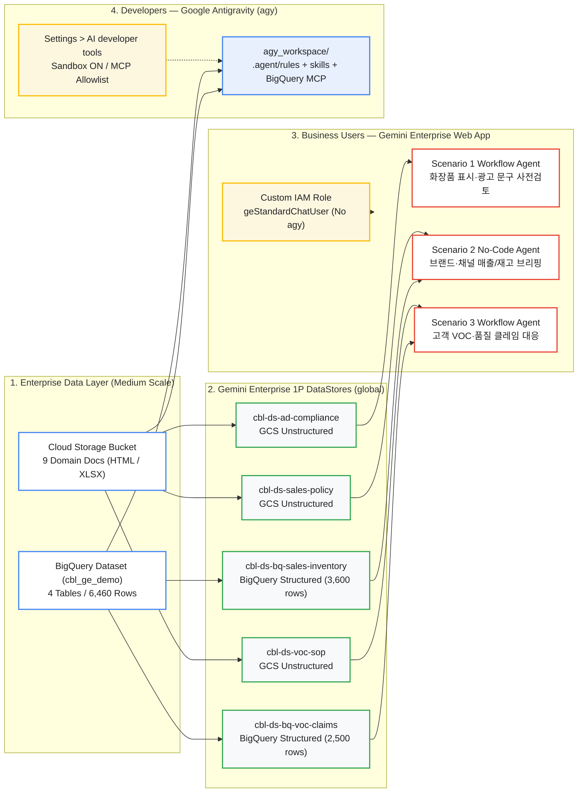

# Gemini Enterprise 1P Connector & Google Antigravity (`agy`) Hands-On Demo Lab

**Google Workspace (`GWS`)를 사용하지 않는 일반 기업 환경**에서 단일 Google Cloud Project와 **30일 무료 체험 `License`(`Free-trial`)**만으로 **Gemini Enterprise (`GE` Web App · 1P `DataStore` · `Agent Designer` `Workflow`)**와 **Google Antigravity (`agy` AI Developer IDE / CLI)**를 구축하고 시연할 수 있는 Step-by-Step Hands-On Lab Repository입니다.

모든 실습 단계(`Setup` ~ `Task 5`)는 비개발자·관리자를 위한 **[Track A: Google Cloud Console / Web UI 따라하기]**와 빠른 재현을 위한 **[Track B: 자동화 Script 실행하기]** 두 가지 경로를 나란히 제공합니다.

---

## 1. End-to-End Lab Architecture

가상 기업 **`Cymbal Beauty & Living` (`CBL` — Beauty · HDB · Refreshment 소비재 기업)**의 정형 실적·클레임 데이터(`BigQuery`)와 비정형 규정·SOP 문서(`Cloud Storage`)를 단일 소스로 구축하고, 현업 임직원용 **`Gemini Enterprise`**와 개발자/AX 담당자용 **`Google Antigravity`**에서 함께 활용합니다.



---

## 2. 사전 요구사항 및 30일 체험 `License` (`Free-trial`) 지원 범위

실습을 시작하기 전에 대상 Google Cloud Project에 연결된 **`Cloud Billing Account` 유형**을 확인하세요. 공식 정책에 따라 30일 무료 체험 `License`의 지원 범위가 아래와 같이 구분됩니다.

| `Cloud Billing Account` 유형 | Gemini Enterprise (`Task 0 ~ Task 3`) | Google Antigravity (`Task 4 ~ Task 5`) | 비고 |
|---|---|---|---|
| **`Invoiced Billing Account`** (후불 청구서 발행 계정 및 하위 `Subaccount`, 사내 Sandbox 포함) | **30일 체험 `License` 가능** | **30일 체험 `License` 가능** (체험 `Quota` 제공) | 단일 30일 체험 구독으로 전 과정(`Task 0 ~ 5`) 실습 가능 |
| **`Self-serve (Online) Billing Account`** (신용카드 자동결제 온라인 계정) | **30일 체험 `License` 가능** | **30일 체험 불가** (`Non-trial` 구독 필요) | `Task 0 ~ 3`은 30일 체험으로 가능하며, `Task 4 ~ 5`는 `Pay-as-you-go`(`Prepaid Credits`) 또는 `Standard`/`Plus` 구독 필요 |

> [!IMPORTANT]
> 모든 `Free-trial` 구독은 한도 초과 종량 과금(`Pay-as-you-go usage above quota`)이 지원되지 않으며, 좌석 배정 직후 백엔드 `Entitlement Cache` 동기화에 5~15분이 소요될 수 있으므로 **`Task 00`에서 무료 체험 활성화와 좌석 배정을 가장 먼저 수행**합니다.

---

## 3. 실습 진행 목차 (Qwiklabs-Style Step-by-Step Guide)

| 단계 | 가이드 문서 | 주요 실습 내용 (`Console UI` + `Script` 병행) | 권장 시간 |
|---|---|---|---|
| **Setup** | [labs/task00_setup_and_trial.md](labs/task00_setup_and_trial.md) | 필수 API 활성화, `GE` 30일 체험 `License` 발급·좌석 할당, `Google Identity` 인증 및 `GE App` 생성 | 10분 |
| **Task 1** | [labs/task01_synthetic_data.md](labs/task01_synthetic_data.md) | 무의존성 Python 기반 중규모 가상 데이터(`BigQuery` 4개 `Table` 6,460 `Row` + `GCS` 문서 9종) 생성 및 적재 | 15분 |
| **Task 2** | [labs/task02_1p_datastores.md](labs/task02_1p_datastores.md) | `GCS`(비정형 3종) 및 `BigQuery`(정형 2종) 1P `DataStore` 생성, 인덱싱 확인 및 `GE App` 연결 | 15분 |
| **Task 3** | [labs/task03_ge_agents_workflows.md](labs/task03_ge_agents_workflows.md) | `GE Agent Designer`에서 3대 업무 `Workflow` / `No-Code Agent` 구성·Publish, 시연 `Prompt` 실행 및 `Canvas` 로컬 파일 반출 | 25분 |
| **Task 4** | [labs/task04_agy_governance_setup.md](labs/task04_agy_governance_setup.md) | 일반 임직원 `Antigravity` 차단 `Custom IAM Role`(`geStandardChatUser`) 생성 및 `Settings > AI developer tools` 보안·`MCP Allowlist` 설정 | 15분 |
| **Task 5** | [labs/task05_agy_hands_on_demo.md](labs/task05_agy_hands_on_demo.md) | `Google Antigravity` 접속(`agy_workspace/`), 도메인 `Rule`·`Skill`·`BigQuery MCP` 기반 배치 광고 검수기 및 운영 분석 실습 + 리소스 정리 | 20분 |

---

## 4. Fast-Track (Script 일괄 구축 Quickstart)

`Console UI`로 `Task 00`의 `GE App` 생성(및 30일 체험 활성화)까지 마친 상태라면, 아래 명령어로 전체 Demo 환경을 한 번에 구축하고 검증할 수 있습니다.

```bash
git clone https://github.com/rhkim77/ge-agy-basic.git
cd ge-agy-basic

# 1. 환경변수 설정 (.env 파일에 본인 PROJECT_ID 및 GE_ENGINE_ID 입력)
cp .env.example .env

# 2. API 활성화 및 라이선스/App 상태 점검
python3 scripts/00_setup_and_check.py

# 3. 중규모 가상 데이터 생성 (외부 pip 패키지 불필요)
bash scripts/01_generate_data.sh

# 4. GCS / BigQuery 적재 및 5개 1P DataStore 생성·GE Engine 연결
python3 scripts/02_provision_1p_datastores.py

# 5. 3개 시나리오 Low-Code / Sequential Workflow Agent 생성
python3 scripts/03_setup_ge_agents.py

# 6. Antigravity 거버넌스 Custom IAM Role 생성 및 MCP Allowlist 검증
python3 scripts/04_setup_antigravity.py

# 7. 전 구간 End-to-End 검증 (Search + StreamAssist + IAM + agy Batch Sample)
python3 scripts/05_verify_all.py

# (실습 종료 후 전체 리소스 순서 보장 정리)
python3 scripts/99_teardown.py
```

---

## 5. 공식 참조 문서 (Official Public References)

1. **Google Cloud — Gemini Enterprise Overview & Setup**: [Set up Gemini Enterprise](https://cloud.google.com/gemini/enterprise/docs/set-up)
2. **Google Cloud — Licenses & 30-Day Free-Trial FAQ**: [Gemini Enterprise Licenses FAQ](https://cloud.google.com/gemini/enterprise/docs/licenses-faqs)
3. **Google Cloud — First-Party Data Stores (Cloud Storage & BigQuery)**: [Create a Cloud Storage data store](https://cloud.google.com/gemini/enterprise/docs/datastore-cloud-storage), [Create a BigQuery data store](https://cloud.google.com/gemini/enterprise/docs/datastore-bigquery)
4. **Google Cloud — Configure Identity Provider (Non-GWS)**: [Configure your identity provider](https://cloud.google.com/gemini/enterprise/docs/configure-identity-provider)
5. **Google Cloud — AI Developer Tools (Google Antigravity) Governance & Custom Roles**: [Configure AI developer tools settings](https://cloud.google.com/gemini/enterprise/docs/ai-developer-tools-settings), [Create custom roles for AI developer tools](https://cloud.google.com/gemini/enterprise/docs/ai-developer-tools-creating-custom-roles)
