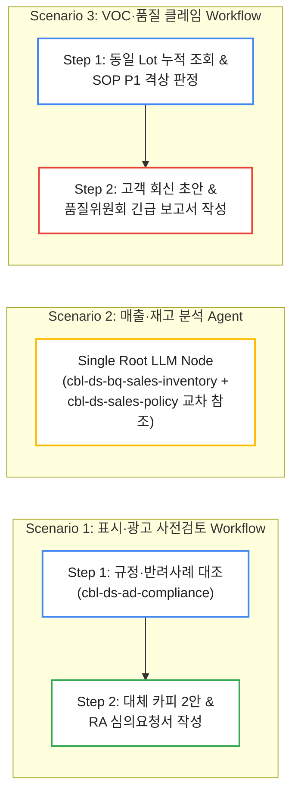

# Task 03: `GE Agent Designer` 기반 `No-Code Agent` & `Workflow` 3종 구성 및 시연

이 단계에서는 별도 서버(`Cloud Run` 등) 구축 없이 일반 현업 임직원이 **Gemini Enterprise Web App (`Agent Designer`)** 안에서 직접 업무용 `Agent`와 다단계 `Workflow`를 구성·공유하고, 비-GWS 환경에서 결과물을 `Canvas` 로컬 파일로 내보내는 과정을 실습합니다.

---

## 1. Track A: `Console` & `GE Web UI` 과정

### Step 1. `GCP Console`에서 `Agent Designer` 및 `Canvas` 기능 켜기
1. `GCP Console > Gemini Enterprise > Apps`에서 대상 `App`을 선택하고 좌측 **`Configurations`**(또는 `Feature settings`) 메뉴로 이동합니다.
2. 아래 항목이 활성화되어 있는지 확인하고 저장합니다:
   - **`Agent Designer` / `No-code agent builder`**: **`On`**
   - **`Workflow agents`**: **`On`**
   - **`Canvas`**: **`On`** *(Google Workspace 없이도 웹에서 생성한 보고서를 로컬 `.docx`, `.pdf`, `.pptx`, `.html` 파일로 내려받을 수 있습니다.)*
   - **`Agent sharing`**: 조직 정책에 따라 `Allow sharing without admin approval` 또는 관리자 승인 모드 선택

### Step 2. `GE Web App` 접속 및 3종 시나리오 `Agent` / `Workflow` 만들기
`Task 00`에서 북마크한 **`GE Web App URL`** 을 브라우저에서 열고 좌측 사이드바의 **`Agents` > `+ Create agent`** (`Agent Designer`)를 클릭합니다. `agents/` 폴더의 JSON 명세서에서 `Instruction`과 `Starter Prompts`를 복사해 아래 3개 `Agent`를 구성할 수 있습니다.



1. **`CBL 표시·광고 문구 사전검토 Workflow`** ([agents/scenario1_ad_compliance_workflow.json](../agents/scenario1_ad_compliance_workflow.json))
   - 유형: `Sequential` / `Workflow` (2단계 순차 노드)
   - `1단계 노드`: `Data store`로 **`cbl-ds-ad-compliance`** 만 체크, `step1_instruction` 붙여넣기
   - `2단계 노드`: `step2_instruction` 붙여넣기 (필요 시 마지막에 `Approval` 노드를 추가해 현업 확인 후 요청서 확정 시연 가능)
   - 우측 상단 **`Publish` / `Share` (`All users`)** 클릭
2. **`CBL 브랜드·채널 실적 및 재고 분석 Agent`** ([agents/scenario2_sales_inventory_agent.json](../agents/scenario2_sales_inventory_agent.json))
   - 유형: 단일 `No-Code / Low-Code Agent`
   - `Data stores`: **`cbl-ds-bq-sales-inventory`**, **`cbl-ds-sales-policy`** 2개 체크, `system_instruction` 붙여넣기 후 **`Publish`**
3. **`CBL VOC·품질 클레임 대응 Workflow`** ([agents/scenario3_voc_claim_workflow.json](../agents/scenario3_voc_claim_workflow.json))
   - 유형: `Sequential` / `Workflow` (2단계 순차 노드)
   - `1단계 노드`: **`cbl-ds-bq-voc-claims`**, **`cbl-ds-voc-sop`** 2개 체크, `step1_instruction` 붙여넣기
   - `2단계 노드`: `step2_instruction` 붙여넣기 후 **`Publish`**

---

## 2. Track B: Script 자동화 과정

Discovery Engine `v1alpha` API(`lowCodeAgentDefinition` — `SequentialAgentNode` 및 `LlmAgentNode`)를 호출해 `Engine` 기능 플래그 활성화와 3개 `Agent` 생성을 한 번에 처리합니다.

```bash
python3 scripts/03_setup_ge_agents.py
```

- `Script`로 생성된 `Agent`는 생성자 계정 기준 `state=PRIVATE` 상태로 `GE Web App > Agents` 목록에 즉시 나타납니다. 다른 테스트 사용자와도 공유하려면 `GE Web App`에서 해당 `Agent`를 열고 **`Share` / `Publish`** 버튼만 눌러 주면 됩니다.

---

## 3. 시나리오별 라이브 시연 `Prompt Playbook` 및 기대 결과

### Scenario 1: 화장품 표시·광고 문구 사전 검토
- **시연 Prompt 1-1**:
  > 더마퓨어 H&B스토어 상세페이지 카피로 "아토피와 피부염을 완벽하게 치료하고 부작용 제로인 저자극 크림"을 쓰려고 해. 사내 표시·광고 가이드라인과 과거 반려 사례를 근거로 위반 사항, 행정처분 리스크, 대체 카피 2안을 제안해줘.
  - **기대 결과**: `RA-AD-2026-01`(화장품법 제13조, 광고업무정지 3개월), 과거 사례 `REV-2026-002` / `REV-2026-008` 인용 → **반려** 판정 및 `"건조함으로 민감해진 피부의 보습 장벽 강화에 도움을 주는 저자극 크림"` 대체안 제시.
- **시연 Prompt 1-2**:
  > 베르당 아쿠아 밤 카피에 "단 1회 사용으로 보습력 145% 개선" 문구를 넣을 때 필수로 기재해야 하는 4대 요건과 과거 조건부승인 사례를 알려줘.
  - **기대 결과**: 인체적용시험 4대 필수 요건(시험기관명·시험기간·대상 인원·개인차 있음) 및 `REV-2026-004` 인용.

### Scenario 2: 브랜드·채널별 매출/재고 분석 및 프로모션 브리핑
- **시연 Prompt 2-1**:
  > 루미에르 로얄 리페어 에센스(SKU-LUMI-001) 면세점 현황과 베르당 아쿠아 밤(SKU-VERD-004) H&B스토어 재고 리스크를 프로모션 운영 정책 및 안전재고 매뉴얼 기준으로 비교 진단해줘.
  - **기대 결과**:
    - `SKU-LUMI-001`(면세점): 현재고 `42개` / 안전재고 `200개`(`21%` → **긴급발주필요**), 프로모션 `PRM-2026-002` ROI `118.4%` < 면세점 최소 목표 `150%` 미달 → 백화점 여유 재고 전환 및 주간 경영회의 보고 권고.
    - `SKU-VERD-004`(H&B스토어): 정기세일(`PRM-2026-001`, 할인율 `25%`, ROI `312.5%`) 급증으로 현재고 `85개` / 안전재고 `300개`(`28.3%` → **긴급발주필요**) → 48시간 이내 긴급 추가 출고 요청.

### Scenario 3: 고객 VOC · 품질 클레임 대응 및 응대 초안
- **시연 Prompt 3-1**:
  > 루트케어 샴푸(SKU-ROOT-001) 제조번호 `LOT-202610-D01`에서 펌프 누액 클레임이 또 접수됐어. 누적 이력과 사내 대응 SOP 기준으로 P1 격상 여부, 필수 조치, 고객 회신 초안을 작성해줘.
  - **기대 결과**: `BigQuery` 이력에서 `LOT-202610-D01` 누적 **18건** 확인 + `QA-SOP-2026-03`(동일 Lot 최근 30일 10건 이상 → **P1-긴급 자동 격상**) 적용 → 4시간 이내 보고·해당 Lot 물류 출고 보류(`Hold`)·품질위원회 긴급 보고서 및 고객 회신 초안 생성.
  - **`Canvas` 반출 시연 팁**: 생성된 품질위원회 보고서를 `Canvas`에서 열어 Google Docs 없이 로컬 `.docx` 또는 `.pdf`로 바로 다운로드하는 흐름을 함께 시연합니다.

다음 단계: [Task 04: Google Antigravity 거버넌스, Custom IAM Role 분리 및 MCP Allowlist 설정](task04_agy_governance_setup.md)
