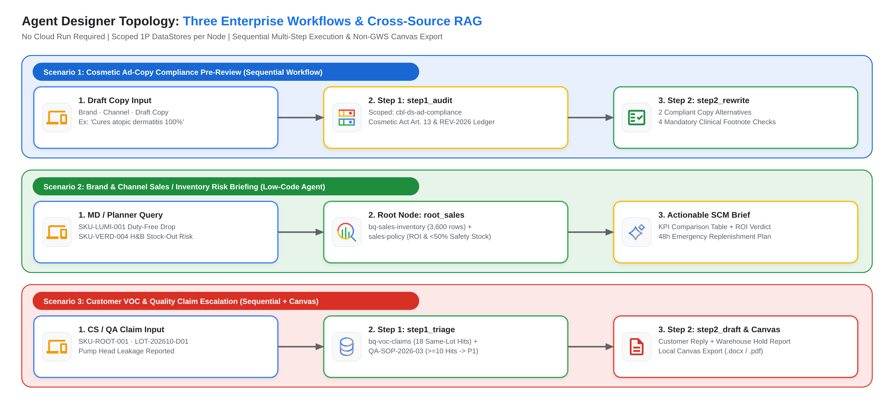
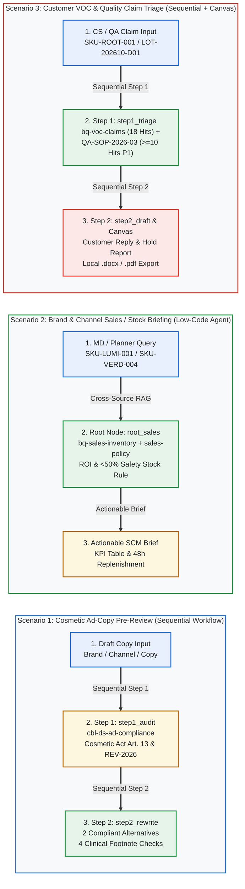

# Task 03: GE Agent Designer 기반 Low-Code Agent & Workflow 3종 구성 및 시연

별도의 `Cloud Run` Server를 구축하지 않고 일반 현업 임직원이 **Gemini Enterprise Web App (`Agent Designer`)** 안에서 직접 업무용 `Agent`와 다단계 `Workflow`를 설계·배포합니다. 아울러 Google Workspace를 쓰지 않는 환경에서 생성된 보고서를 `Canvas` 로컬 File (`.docx`, `.pdf`)로 내려받는 흐름까지 함께 실습합니다.



- **편집 가능한 Workflow Diagram 원본**: [3-Page 통합 Workbook (`ge_agy_architecture_diagrams.drawio`)](../assets/diagrams/ge_agy_architecture_diagrams.drawio) · [단일 Page (`02_three_scenario_workflows.drawio`)](../assets/diagrams/02_three_scenario_workflows.drawio) · [Vector SVG (`02_three_scenario_workflows.svg`)](../assets/diagrams/02_three_scenario_workflows.svg)

<details>
<summary><b>Mermaid Diagram 원본 보기 (GitHub Native Flowchart)</b></summary>



</details>

---

## 1. Track A: Console & GE Web UI 과정

### Step 1. GCP Console에서 Agent Designer 및 Canvas 기능 켜기

1. `GCP Console > Gemini Enterprise > Apps`에서 대상 `App`을 선택한 뒤 좌측 **`Configurations`** (또는 `Feature settings`) Menu로 이동합니다.
2. 아래 항목이 활성화되어 있는지 확인하고 저장합니다.
   - **`Agent Designer` / `No-code agent builder`**: **`On`**
   - **`Workflow agents`**: **`On`**
   - **`Canvas`**: **`On`** (`Google Workspace` 없이도 생성된 보고서를 로컬 `.docx`, `.pdf`, `.pptx`, `.html` File로 바로 내려받을 수 있습니다.)
   - **`Agent sharing`**: 조직 보안 기준에 따라 `Allow sharing without admin approval` 또는 관리자 승인 Mode 선택

### Step 2. GE Web App 접속 및 3종 시나리오 Agent / Workflow 만들기

`Task 00`에서 저장해 둔 **`GE Web App URL`** 을 Browser에서 열고 좌측 Sidebar의 **`Agents` > `+ Create agent`** (`Agent Designer`)를 클릭합니다. [agents/](../agents/) Folder 안의 JSON 명세서에서 `Instruction`과 `Starter Prompts`를 복사해 아래 3개 `Agent`를 차례대로 구성합니다.

1. **`CBL 표시·광고 문구 사전검토 Workflow`** ([agents/scenario1_ad_compliance_workflow.json](../agents/scenario1_ad_compliance_workflow.json))
   - 유형: `Sequential` / `Workflow` (2단계 순차 `Node`)
   - 1단계 `Node` (`step1_audit`): `Data store`로 **`cbl-ds-ad-compliance`** 만 선택하고 `step1_instruction` 붙여넣기
   - 2단계 `Node` (`step2_rewrite`): `step2_instruction` 붙여넣기 (필요하면 마지막에 `Approval` `Node`를 붙여 현업 확인 후 RA 심의요청서를 확정하는 흐름도 시연할 수 있습니다.)
   - 우측 상단 **`Publish` / `Share` (`All users`)** 클릭
2. **`CBL 브랜드·채널 실적 및 재고 분석 Agent`** ([agents/scenario2_sales_inventory_agent.json](../agents/scenario2_sales_inventory_agent.json))
   - 유형: 단일 `Low-Code Agent` (`root_sales`)
   - `Data stores`: **`cbl-ds-bq-sales-inventory`**, **`cbl-ds-sales-policy`** 2개를 함께 지정한 뒤 `system_instruction`을 붙여넣고 **`Publish`** 클릭
3. **`CBL VOC·품질 클레임 대응 Workflow`** ([agents/scenario3_voc_claim_workflow.json](../agents/scenario3_voc_claim_workflow.json))
   - 유형: `Sequential` / `Workflow` (2단계 순차 `Node`)
   - 1단계 `Node` (`step1_triage`): **`cbl-ds-bq-voc-claims`**, **`cbl-ds-voc-sop`** 2개를 지정하고 `step1_instruction` 붙여넣기
   - 2단계 `Node` (`step2_draft`): `step2_instruction` 붙여넣기 후 **`Publish`** 클릭

---

## 2. Track B: Script 자동화 과정

Discovery Engine `v1alpha` API (`lowCodeAgentDefinition`: `SequentialAgentNode` 및 `LlmAgentNode`)를 호출해 `Engine` 기능 Flag 활성화와 3개 `Agent` 등록을 한 번에 처리합니다.

```bash
python3 scripts/03_setup_ge_agents.py
```

- `Script`로 생성한 `Agent`는 생성자 계정 기준 `state=PRIVATE` 상태로 `GE Web App > Agents` 목록에 바로 등록됩니다. 다른 Test 사용자 계정에서도 조회하려면 `GE Web App`에서 각 `Agent`를 열어 **`Share` / `Publish`** 버튼만 눌러 주면 됩니다.

---

## 3. 시나리오별 라이브 시연 Prompt Playbook 및 기대 결과

### Scenario 1: 화장품 표시·광고 문구 사전 검토

- **시연 Prompt 1-1**
  > 더마퓨어 H&B스토어 상세페이지 카피로 "아토피와 피부염을 완벽하게 치료하고 부작용 제로인 저자극 크림"을 쓰려고 해. 사내 표시·광고 가이드라인과 과거 반려 사례를 근거로 위반 사항, 행정처분 리스크, 대체 카피 2안을 제안해줘.
  - **기대 결과**: `RA-AD-2026-01` (화장품법 제13조 위반, 광고업무정지 3개월)과 과거 심의 이력 `REV-2026-002` / `REV-2026-008`을 근거로 **반려** 판정을 내리고 `"건조함으로 민감해진 피부의 보습 장벽 강화에 도움을 주는 저자극 크림"` 등 대체 카피 2안을 제시합니다.

- **시연 Prompt 1-2**
  > 베르당 아쿠아 밤 카피에 "단 1회 사용으로 보습력 145% 개선" 문구를 넣을 때 필수로 기재해야 하는 4대 요건과 과거 조건부승인 사례를 알려줘.
  - **기대 결과**: 인체적용시험 4대 필수 각주 요건(시험기관명·시험기간·대상 인원·개인차 있음)과 조건부승인 이력 `REV-2026-004`를 함께 인용합니다.

### Scenario 2: 브랜드·채널별 매출/재고 분석 및 프로모션 브리핑

- **시연 Prompt 2-1**
  > 루미에르 로얄 리페어 에센스(SKU-LUMI-001) 면세점 현황과 베르당 아쿠아 밤(SKU-VERD-004) H&B스토어 재고 리스크를 프로모션 운영 정책 및 안전재고 매뉴얼 기준으로 비교 진단해줘.
  - **기대 결과**:
    - `SKU-LUMI-001` (면세점): 현재고 `42개` / 안전재고 `200개` (`21%`, **긴급발주필요**), 프로모션 `PRM-2026-002` ROI `118.4%`로 면세점 최소 목표(`150%`)에 미달함을 짚어내고 백화점 여유 재고 전환과 주간 경영회의 안건 상정을 권고합니다.
    - `SKU-VERD-004` (H&B스토어): 정기세일(`PRM-2026-001`, 할인율 `25%`, ROI `312.5%`) 판매 급증으로 현재고 `85개` / 안전재고 `300개` (`28.3%`, **긴급발주필요**) 상태임을 확인하고 48시간 이내 긴급 추가 출고를 요청합니다.

### Scenario 3: 고객 VOC · 품질 클레임 대응 및 응대 초안

- **시연 Prompt 3-1**
  > 루트케어 샴푸(SKU-ROOT-001) 제조번호 `LOT-202610-D01`에서 펌프 누액 클레임이 또 접수됐어. 누적 이력과 사내 대응 SOP 기준으로 P1 격상 여부, 필수 조치, 고객 회신 초안을 작성해줘.
  - **기대 결과**: `BigQuery` 이력에서 `LOT-202610-D01` 동일 Lot 클레임 **18건** 누적을 확인하고 `QA-SOP-2026-03` (동일 Lot 최근 30일 10건 이상 시 **P1-긴급 자동 격상**) 기준을 적용합니다. 4시간 이내 품질보증팀 보고, 해당 Lot 물류 출고 보류(`Hold`), 품질위원회 긴급 보고서 및 고객 회신 초안을 순서대로 작성합니다.
  - **Canvas 반출 시연 Tip**: 작성된 품질위원회 보고서를 `Canvas`에서 열어 Google Docs 연동 없이 로컬 `.docx` 또는 `.pdf` File로 곧바로 Download하는 장면을 함께 보여주면 효과적입니다.

다음 단계: [Task 04: Google Antigravity Governance, Custom IAM Role 분리 및 MCP Allowlist 설정](task04_agy_governance_setup.md)
