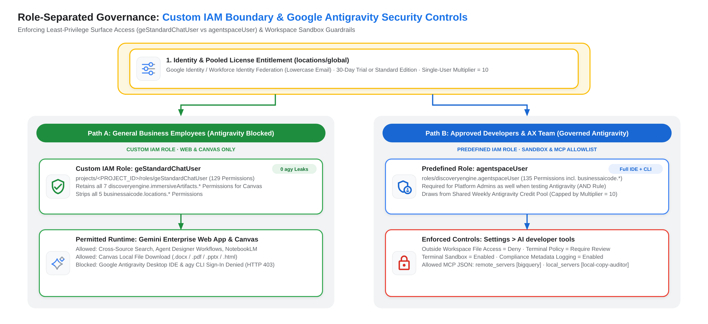
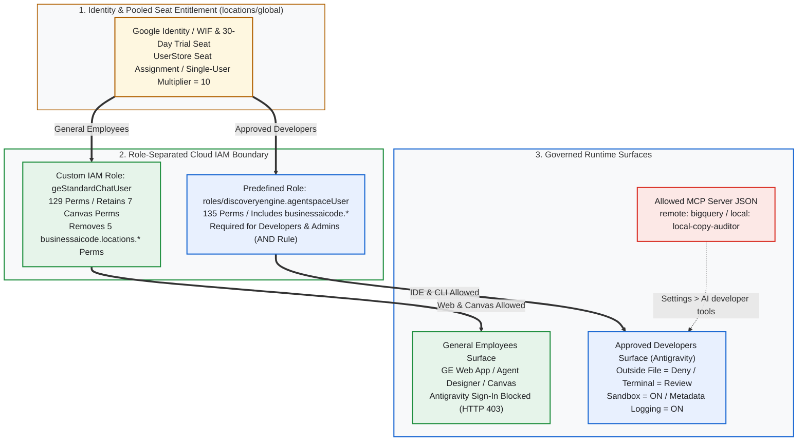

# Task 04: Google Antigravity Governance, Custom IAM Role 분리 및 MCP Allowlist 설정

기업에서 `Gemini Enterprise` 좌석을 배포할 때 표준 역할(`roles/discoveryengine.agentspaceUser`)을 그대로 부여하면 모든 사용자에게 `Google Antigravity`(`AI developer tools`) 접근 권한까지 함께 열립니다. 실무 운영 환경에서는 **일반 현업 임직원에게는 GE Web App과 Canvas만 허용**(`Antigravity` 차단)하고 **승인된 개발자·AX 담당자에게만 Antigravity를 개방**하는 직무별 권한 분리와 로컬 실행 통제가 필수입니다.



- **편집 가능한 Governance Diagram 원본**: [3-Page 통합 Workbook (`ge_agy_architecture_diagrams.drawio`)](../assets/diagrams/ge_agy_architecture_diagrams.drawio) · [단일 Page (`03_iam_and_antigravity_governance.drawio`)](../assets/diagrams/03_iam_and_antigravity_governance.drawio) · [Vector SVG (`03_iam_and_antigravity_governance.svg`)](../assets/diagrams/03_iam_and_antigravity_governance.svg)

<details>
<summary><b>Mermaid Diagram 원본 보기 (GitHub Native Flowchart)</b></summary>



</details>

---

## 1. 직무별 Cloud IAM 역할 분리 구조

| 대상 직군 | 부여할 IAM Role | GE Web App / Canvas | Google Antigravity (`agy`) |
|---|---|---|---|
| **일반 현업 임직원** | `projects/<PROJECT_ID>/roles/geStandardChatUser` (`Custom Role`) | **허용** (`immersiveArtifacts.*` 7종 유지) | **차단** (`businessaicode.*` 5종 제외) |
| **승인 개발자 / AX 담당자** | `roles/discoveryengine.agentspaceUser` (`Gemini Enterprise User`) | **허용** | **허용** |
| **플랫폼 관리자** (`Admin`) | `roles/discoveryengine.agentspaceAdmin` 및 `roles/discoveryengine.agentspaceUser` | **허용** | **허용** (`Admin` 단독 역할만으로는 `Antigravity` 실행 불가하므로 반드시 `User` 역할을 함께 부여) |

---

## 2. Track A: Google Cloud Console UI 과정

### Step 1. 일반 임직원용 Antigravity 차단 Custom IAM Role 확인 및 부여

> [!IMPORTANT]
> `Canvas` 기능에 필요한 `discoveryengine.immersiveArtifacts.*` 권한 일부는 Preview 단계여서 `Console UI`의 역할 복제 화면만으로는 누락될 수 있습니다. 역할 생성 자체는 아래 `Track B`의 `04_setup_antigravity.py`(또는 `gcloud iam roles create`)로 먼저 수행한 뒤 `GCP Console > IAM & Admin > IAM`에서 사용자 Group별 권한 부여를 진행하세요.

1. `GCP Console > IAM & Admin > Roles`에서 `GE Standard Chat User (No Antigravity)`(`geStandardChatUser`) 역할을 열어 총 129개 권한 중 `businessaicode.locations.*` 권한이 모두 빠져 있는지 확인합니다.
2. `IAM & Admin > IAM`에서 `+ GRANT ACCESS`를 눌러 직군별로 역할을 매핑합니다.
   - 일반 현업 사용자 및 Group: `Custom > GE Standard Chat User (No Antigravity)` 부여
   - 승인 개발자 Group 및 실습 본인 계정: `Gemini Enterprise User`(`roles/discoveryengine.agentspaceUser`) 부여

### Step 2. Settings > AI developer tools 보안 및 MCP Allowlist 구성

1. `GCP Console > Gemini Enterprise > Settings`로 이동한 뒤 상단 Tab에서 `AI developer tools`를 선택합니다 (상단 `Region`: `global` 확인).
2. `AI developer tools` 마스터 Toggle을 `On`으로 켭니다. 비활성화 상태였다면 Console이 자동으로 `businessaicode.googleapis.com` API를 점검하고 활성화합니다.
3. 아래 권장 Enterprise 보안 정책을 차례대로 적용합니다.
   - **Security > Outside workspace file access**: `Deny` (열어 둔 Workspace Folder 바깥의 로컬 File 접근 차단)
   - **Security > Terminal execution policy**: `Require review` (`Agent`가 Shell 명령어를 실행하기 전에 개발자 승인을 반드시 거치도록 강제)
   - **Security > Terminal sandbox**: `Enabled`
   - **Compliance > Metadata logging**: `Enabled` (`Cloud Logging`의 `businessaicode.googleapis.com/inference_response` Stream을 통해 사용자별 Token 소비량과 활성 이력을 감사)
4. **MCP Server 통제** (`Allowed server configuration`) 입력란에 [agy_workspace/configs/mcp_allowlist.json](../agy_workspace/configs/mcp_allowlist.json) 내용을 붙여넣고 `Save`를 클릭합니다.

```json
{
  "mcpServers": {
    "local_servers": [
      {
        "id": "local-copy-auditor",
        "command": "python3",
        "args": [
          "samples/batch_copy_validator.py",
          "--stdio-check"
        ]
      }
    ],
    "remote_servers": [
      {
        "id": "bigquery"
      }
    ]
  }
}
```

### Step 3. 주간 공유 Credit 독점 방지 (Usage & spend)

1. 좌측 Menu `Gemini Enterprise > Usage & spend`로 이동합니다.
2. `Pay-as-you-go usage above quota` 항목이 `Disabled` 상태인지 확인합니다 (30일 체험 `License`에서는 기본 비활성).
3. 특정 개발자 1명이 조직의 주간 공유 `Antigravity Credit Pool`을 독점 소진하지 못하도록 `Limit any single-user's quota (Multiplier)` 값을 `10`으로 지정해 저장합니다.

---

## 3. Track B: Script 자동화 과정

아래 `Script`는 `businessaicode.googleapis.com` API 활성화, `gcp-sa-businessaicode` `Service Identity` 프로비저닝, 최신 `roles/discoveryengine.agentspaceUser` 권한 목록 기반 `geStandardChatUser` `Custom Role` 생성·갱신, 그리고 `mcp_allowlist.json` 문법 검증을 자동으로 수행합니다.

```bash
python3 scripts/04_setup_antigravity.py
```

다음 단계: [Task 05: Google Antigravity 접속 및 Domain Rule · Skill · BigQuery 연계 실습](task05_agy_hands_on_demo.md)
